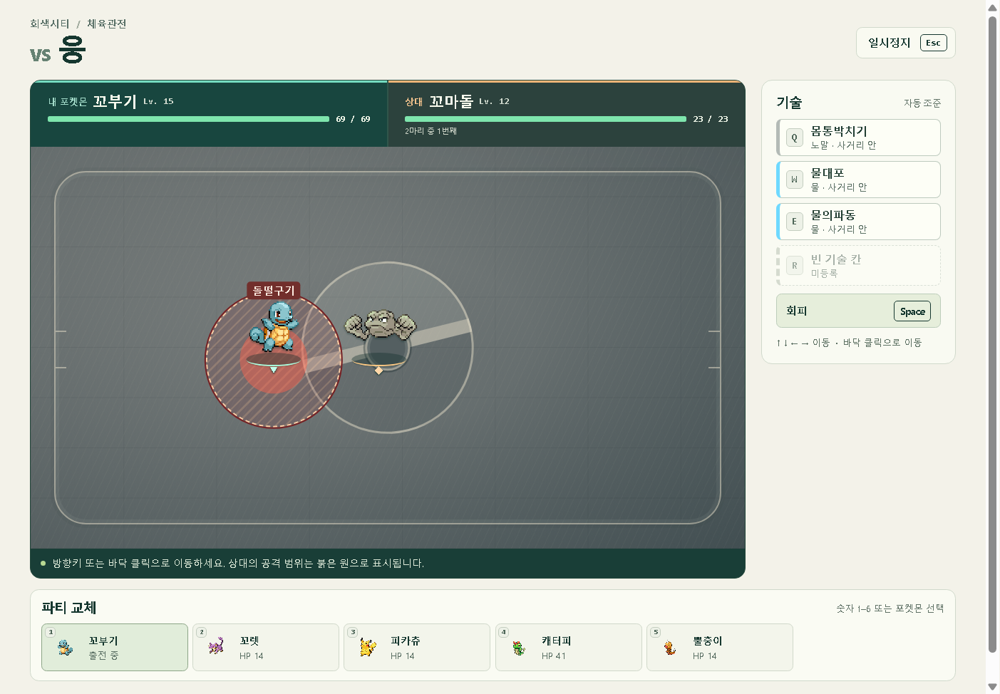

# 포켓몬 데스크톱 어드벤처

Windows 바탕화면에서 포켓몬과 함께하는 자동 육성 게임입니다. 1~9세대 스타팅 27종 중 한 마리로 모험을 시작합니다. 파티는 바탕화면을 산책하고, 첫 번째 자리에 있는 포켓몬이 야생 포켓몬과 싸우며 성장합니다.

## 실행

Windows x64에서는 [설치 파일](https://github.com/Dongsusin/pokemon-desktop-adventure/releases/download/v0.20.0/Pokemon-Desktop-Adventure-0.20.0-Setup.exe)을 실행한 뒤 시작 메뉴에서 **Pokémon Desktop Adventure**를 엽니다.

소스 코드로 실행하려면 Windows 10 또는 11의 PowerShell에서 프로젝트 폴더를 엽니다. Node.js 22.12 이상과 npm이 필요합니다.

```powershell
npm ci
npm run dev
```

1. 관리 창 상단에서 빈 저장 슬롯을 고릅니다. 세대와 타입으로 후보를 좁히고 파트너를 선택합니다.
2. **이 포켓몬으로 시작**을 누르면 레벨 5로 모험을 시작합니다. 상태, 지도, 도전, 포켓몬, 파티, 도감, 가방, 전투 기록 탭에서 진행 상황을 확인할 수 있습니다.
3. **바탕화면에서 보기**를 누르면 관리 창이 숨겨지고 투명 오버레이가 표시됩니다. 전투, 포획, 아이템 드롭과 줍기, 진화가 파트너 주변에서 재생됩니다.
4. 트레이 메뉴의 **관리 창 열기**로 돌아올 수 있습니다. 자동 사냥을 멈추거나 캐릭터 표시를 끄는 것도 트레이에서 가능합니다. 앱을 끝낼 때는 **완전히 종료**를 선택합니다.

## 관동지방 지도

첨부된 관동 일러스트를 **지도**의 배경으로 사용합니다. 도로, 마을, 도시, 동굴을 고르고 **이곳으로 이동**을 누릅니다. 같은 지도 좌표에 장소가 여러 개 겹치면 오른쪽에서 원하는 장소를 선택할 수 있습니다. 장소 목록으로도 고를 수 있습니다.

《포켓몬스터 레드》 기준 도로 1–25와 주요 거점의 위치, 원작 지형 이미지, 출현 종과 레벨을 제공합니다. 풀숲과 물 위의 일반 출현표를 사용하고, 여러 층이 있는 동굴은 장소 단위로 출현표를 합칩니다. 낚시가 필요한 마을과 도시는 산책 지역으로 사용합니다. 새 모험은 태초마을에서 시작하고, 기존 저장은 업데이트 후 1번도로에서 이어집니다.

프리져는 쌍둥이섬, 썬더는 무인발전소, 파이어는 챔피언로드, 뮤츠는 블루동굴에 출현 판정당 약 0.65% 확률로 나타납니다. 체육관의 실제 위치와 관장, 석영고원 리그 위치를 확인할 수 있습니다. [지도와 지형 이미지 출처](assets/maps/kanto/SOURCES.md)

## 체육관·리그 실시간 배틀



관동부터 팔데아까지 **체육관 도전**이나 **리그 도전**을 누르면 배틀 경기장에 입장합니다. 선두 포켓몬으로 거리를 좁히고 기술을 쓰거나, 상대가 조준을 마치는 순간 옆으로 굴러 피할 수 있습니다. 꼬부기의 물대포는 앞쪽으로 뻗는 빔이고, 잎날가르기는 세 갈래로 퍼집니다. 돌떨구기는 바위가 착지하는 지점에 피해를 줍니다. 기술 버튼에 마우스를 올리면 사거리와 예상 경로가 표시됩니다. 상대가 범위 밖에 있어도 기술은 발동해, 투사체가 최대 거리까지 날아가며 공격을 빗맞힐 수 있습니다. [실제 실행 영상](docs/screenshots/trainer-battle.gif)

물대포·전기쇼크·용의숨결은 상대에게 닿아 있는 동안 0.2초 간격으로 피해를 줍니다. 빔 둘이 정면에서 만나면 양쪽 빔이 충돌점에서 멈추고 힘겨루기가 시작됩니다. 기술 위력과 타입 상성, 포켓몬의 능력치에 따라 충돌점이 밀리고 어느 한쪽이 돌파하거나 무승부로 끝납니다. 빔과 투사체는 포켓몬의 폼, 바라보는 방향과 발사 동작에 맞는 위치에서 나갑니다. [피카츄와 별가사리의 실제 힘겨루기](docs/screenshots/beam-clash.gif)

[포켓몬 레조넌스 v3.0.0](https://reso.jhcloud.kr/)을 기준으로 1,200 × 760 전장과 기술별 궤적, 발사 속도, 준비 시간, 2회 연속 회피를 적용했습니다. 원본에 여덟 방향의 이동·공격 동작이 있는 기본 모습 961종과 추가 모습 44개가 출전합니다. 각 포켓몬은 배울 수 있는 기술 중 해당 동작이 있는 기술만 씁니다. 예를 들어 전기쇼크는 피카츄가 사용할 수 있고, 전용 발사 동작이 없는 피츄의 기술 목록에서는 제외됩니다. 회색체육관, 블루체육관, 신오 체육관 등에는 실제 체육관 타일이 깔리며, 전용 배경이 없는 곳은 트레이너의 타입에 맞는 곳에서 대결합니다. [그림과 전장 출처](assets/battle/SOURCES.md)

| 조작 | 키 또는 마우스 |
| --- | --- |
| 이동 | 방향키 · Alt + 바닥 클릭 · 터치 |
| 장착 기술 1~4 | Q · W · E · R |
| 기술 1·2 | 마우스 왼쪽·오른쪽 버튼 |
| 회피 | Space · Shift |
| 파티 포켓몬 교체 | 1~6 |
| 일시정지·계속 | Esc |

출전한 포켓몬이 쓰러지면 남은 파티원 중 다음 포켓몬을 고릅니다. 대전이 끝나면 출전 전 파티 순서로 돌아갑니다. 창을 숨기거나 다른 창으로 전환하면 일시정지되며, 저장한 도전은 다시 열어 이어갈 수 있습니다. 바탕화면 사냥, 자동 포획, 아이템 획득은 평소처럼 진행됩니다.

## 체육관과 관동 리그

1. **도전** 탭에 표시된 순서대로 다음 체육관이 있는 도시로 이동합니다. 지도 상세 화면이나 **도전** 탭에서 **체육관 도전**을 누릅니다. 배틀 화면에서 파티를 직접 조작해 관장의 마지막 포켓몬까지 이기면 배지를 얻습니다.
2. **도전** 탭에서 배지 8개와 각 체육관 위치를 확인할 수 있습니다. 배지를 모두 얻으면 석영고원에서 **리그 도전**을 시작합니다.
3. 칸나, 시바, 국화, 목호를 차례로 이긴 뒤 챔피언 그린을 이기면 관동 리그 우승이 저장됩니다. 대전 사이에 대표 포켓몬의 HP가 회복됩니다. 리그에서 패배하거나 석영고원을 떠나면 칸나부터 다시 도전합니다.

관장과 리그 상대의 팀은 《포켓몬스터 레드》의 순서와 레벨을 바탕으로 구성하며, 전용 모션이 있는 포켓몬이 출전합니다. 그린의 마지막 팀 구성은 스타팅 타입에 따라 달라집니다. [원작 트레이너 파티](https://github.com/pret/pokered/blob/ba9c0568f64ae602fadda577a08c66639f93082a/data/trainers/parties.asm) · [체육관 배지 도트](https://github.com/pret/pokered/blob/ba9c0568f64ae602fadda577a08c66639f93082a/gfx/trainer_card/badges.png)

## 성도지방과 성도 리그

관동 리그에서 그린을 이기면 관리 창에 **성도지방으로 이동**이 표시됩니다. 연두마을에서 출발하며, **지도**에서 도로와 마을, 동굴을 포함한 52개 장소에 이동할 수 있습니다. 지도는 《포켓몬스터 금》 포켓기어의 성도 화면에 석영고원으로 이어지는 관동 화면 일부를 연결했습니다. 지역별 풀숲, 동굴, 파도타기 포켓몬의 종류와 레벨을 지도에서 확인할 수 있습니다. 방울탑의 칠색조와 소용돌이섬의 루기아는 각 장소의 출현 판정당 0.65% 확률로 등장합니다. [지도와 출현표 출처](assets/maps/johto/SOURCES.md)

비상부터 이향까지 관장을 순서대로 이겨 성도 배지 8개를 모으면 석영고원에서 성도 리그에 도전할 수 있습니다. 일목, 독수, 시바, 카렌을 거쳐 목호를 이기면 성도 리그 우승이 저장됩니다. [원작 트레이너 파티](https://github.com/pret/pokegold/blob/2bbfba60051acfbed96d68fb5e40173a06df67d8/data/trainers/parties.asm) · [원작 성도 배지](https://github.com/pret/pokegold/blob/2bbfba60051acfbed96d68fb5e40173a06df67d8/gfx/trainer_card/badges.png)

## 호연지방과 호연 리그

성도 리그에서 목호를 이기면 관리 창에 **호연지방으로 이동**이 열립니다. 미로마을에서 시작해 《포켓몬스터 에메랄드》 포켓나비 지도에서 101~134번도로, 마을과 던전을 선택할 수 있습니다. 장소 상세에는 야생 포켓몬의 종류와 레벨이 표시됩니다. [지도 출처](assets/maps/hoenn/SOURCES.md) · [출현표 출처](assets/maps/hoenn/ENCOUNTERS.md)

원규부터 아단까지 체육관을 순서대로 이겨 호연 배지 8개를 모으세요. 이끼시티의 풍·란은 원작 팀 네 마리를 차례로 내보냅니다. 포켓몬리그에서 사천왕 혁진, 회연, 미혜, 권수와 챔피언 윤진을 이기면 호연 우승이 저장됩니다. [트레이너와 배지 출처](assets/maps/hoenn/TRAINERS.md)

## 신오지방과 신오 리그

호연 챔피언 윤진을 이기면 관리 창의 **신오지방으로 이동**을 눌러 떡잎마을에서 시작할 수 있습니다. 《포켓몬스터Pt 기라티나》의 지도에서 201~230번도로를 포함한 90곳의 마을, 호수, 동굴과 도로를 선택해 장소별 출현 포켓몬과 레벨을 확인할 수 있습니다. [지도 출처](assets/maps/sinnoh/SOURCES.md) · [출현표 기준](assets/maps/sinnoh/ENCOUNTERS.md)

일반 포켓몬 127종은 도보와 파도타기 출현표를 사용합니다. 깨어진 세계에서는 기라티나 Lv.47, 창기둥에서는 디아루가와 펄기아 Lv.70을 만날 수 있습니다. 창기둥의 희귀 출현 확률은 합계 0.65%이며 두 종에 0.325%씩 배정됩니다. 원작에서 배포 이벤트로 열던 장소에서도 희귀 조우를 사용할 수 있습니다.

체육관은 강석, 유채, 멜리사, 자두, 맥실러, 동관, 무청, 전진 순서로 도전합니다. 배지 8개를 모으면 사천왕 충호, 들국화, 대엽, 오엽을 거쳐 챔피언 난천과 대결합니다. [트레이너와 배지 출처](assets/maps/sinnoh/TRAINERS.md)

## 하나지방과 하나 리그

신오 챔피언 난천을 이긴 뒤 **하나지방으로 이동**을 누르면 부채시티에서 모험을 시작합니다. 《포켓몬스터 블랙 2》의 지도에서 19번도로를 포함한 도로 22개와 도시, 동굴 등 93곳을 선택해 이동할 수 있습니다. 장소 상세에서 야생 포켓몬의 종류와 레벨을 확인할 수 있습니다. [지도 출처](assets/maps/unova/SOURCES.md) · [출현표 기준](assets/maps/unova/ENCOUNTERS.md)

일반 포켓몬 141종은 58곳의 일반 풀숲·짙은 풀숲·동굴·파도타기 표에서 등장합니다. 네 계절의 출현표를 합산하며, 용나선탑의 제크로무 Lv.70, 자이언트홀의 큐레무 Lv.70, 꿈터의 라티오스 Lv.68은 블랙 2에 맞춘 희귀 조우로 만날 수 있습니다.

체렌부터 시즈까지 체육관 관장 8명을 이기면 하나 포켓몬리그에 도전할 수 있습니다. 도전 화면에서 원하는 사천왕을 골라 배틀하세요. 이번 도전에서 네 명 모두에게 이기면 챔피언 아이리스와 대결합니다. 리그 도중 패배하거나 장소를 떠나면 사천왕에게 다시 도전합니다. 팀 구성과 레벨은 블랙 2의 노멀 모드 첫 도전 기준입니다. [트레이너와 배지 출처](assets/maps/unova/TRAINERS.md)

## 칼로스지방과 칼로스 리그

하나 리그에서 아이리스를 이기면 관리 창에서 **칼로스지방으로 이동**을 눌러 조아마을로 갈 수 있습니다. 《포켓몬스터 X》의 타운맵에서 1~22번도로를 포함한 63곳을 선택해 이동할 수 있습니다. 일반 출현 장소 36곳에는 포켓몬 270종이 등장합니다. 1번도로에서는 야생 포켓몬을 만나지 않으며, 기남시티 프렌드사파리에서는 친구 코드 없이 Lv.30 포켓몬을 만날 수 있습니다. [지도 출처](assets/maps/kalos/SOURCES.md) · [출현표 기준](assets/maps/kalos/ENCOUNTERS.md)

플레어단 비밀기지에서는 제르네아스 Lv.50을 만날 수 있습니다. 칼로스 리그에서 우승한 뒤에는 끝의 동굴의 지가르데와 이름없는 동굴의 뮤츠가 열립니다. 해신의 굴에서는 처음 고른 파트너가 풀 계열이면 프리져, 불꽃이면 썬더, 물이면 파이어가 Lv.70으로 출현합니다. 해당 장소에서 전설을 만날 확률은 출현 판정당 0.65%입니다.

백단시티에서 비올라에게 첫 배지를 얻고 이설시티에서 우르프에게 여덟 번째 배지를 얻으면 레벨 상한이 100이 됩니다. 칼로스 포켓몬리그에서는 사천왕 네 명을 원하는 순서로 이긴 뒤 챔피언 카르네에게 도전합니다. [트레이너와 배지 출처](assets/maps/kalos/TRAINERS.md)

## 알로라지방과 섬 순례

칼로스 리그에서 카르네를 이긴 뒤 **알로라지방으로 이동**을 누르면 멜레멜레섬 1번도로에서 시작합니다. 《포켓몬스터 썬》의 공식 일러스트 지도에서 네 섬을 확대하고 1~17번도로, 에테르파라다이스 등 82곳을 선택할 수 있습니다. **도전** 탭의 섬 순례 목록에서 다음 장소를 찾을 수 있습니다. [지도 출처](assets/maps/alola/SOURCES.md) · [장소별 출현 자료](assets/maps/alola/ENCOUNTERS.md)

일반 포켓몬 146종은 산책 장소 59곳에 등장합니다. 일륜의 제단에서는 솔가레오 Lv.55를, 리그 우승 후에는 네 유적의 카푸 수호신과 네크로즈마, 《썬》의 울트라비스트 다섯 종을 지정 장소에서 만날 수 있습니다. 희귀 출현 확률은 장소별 판정당 합계 0.65%입니다.

주인 포켓몬의 시련 7개와 섬의 대표가 진행하는 큰 시련 4개를 원작 순서대로 완료해 Z크리스탈을 모읍니다. 데스크톱에서는 시련의 주인 포켓몬과 1대1로 배틀합니다. 우거진 동굴에서는 형사구스의 전용 모션이 없어 《문》 버전의 주인 알로라 레트라(Lv.12)가 출전합니다. 주인 오라가 올리는 능력치가 도전 화면에 표시되고 실제 배틀에 적용됩니다. 알로라의 레벨 상한은 25부터 시작해 처음 열 번의 승리마다 5씩 올라가며, 열한 번째 시련을 완료하면 100이 됩니다.

라나키라마운틴의 포켓몬리그에서 사천왕 네 명에게 원하는 순서로 승리한 뒤 쿠쿠이박사와 초대 챔피언 결정전을 치릅니다. 박사의 마지막 포켓몬은 파트너의 스타팅 타입에 따라 달라집니다. [시련·리그 파티와 보상](assets/maps/alola/TRAINERS.md)

알로라 꼬렛처럼 지역 모습이 다른 포켓몬은 도트와 타입, 능력치를 구분합니다. 포획 후 다른 지방으로 이동해도 파티와 보관함에는 잡았을 때의 모습이 남습니다. 주인 약어리는 군집의 모습으로 배틀을 시작하며 HP가 4분의 1 이하가 되면 단독의 모습으로 바뀝니다.

## 가라르지방과 챔피언컵

알로라 리그에서 쿠쿠이박사에게 이기면 **가라르지방으로 이동**이 열립니다. 《포켓몬스터 소드》 본편의 펄롱마을에서 시작합니다. **지도**에서 여섯 권역을 확대해 1~10번도로와 와일드에리어 17구역 등 본토 62곳을 선택할 수 있습니다. 일반 야생 포켓몬 301종이 40개 장소에 등장합니다. 와일드에리어의 장소 상세에 오늘의 날씨와 그날 만날 수 있는 포켓몬의 레벨·확률이 표시됩니다. 날짜별 날씨는 본편의 공통 날씨 지정일과 지역별 일일 순환 규칙을 조합했습니다. [타운맵 출처](assets/maps/galar/SOURCES.md) · [야생 출현 자료](assets/maps/galar/ENCOUNTERS.md)

터프마을의 아킬부터 너클시티의 금랑까지 여덟 관장에게 승리하면 상한이 100이 됩니다. 슛스타디움에서 **챔피언컵 도전**을 누르고 마리, 호브, 비트, 야청, 채두, 금랑을 거쳐 단델과 챔피언매치를 치르세요. 호브와 단델의 팀은 파트너의 스타팅 타입에 따라 달라집니다. 진행 도중 스타디움을 떠나거나 패배하면 첫 경기부터 다시 도전합니다. [관장·챔피언컵 파티와 배지 출처](assets/maps/galar/TRAINERS.md)

다이맥스를 사용하는 상대의 에이스가 등장하면 대표 포켓몬도 함께 다이맥스합니다. 양쪽이 세 번씩 행동하는 동안 최대 HP가 1.5배가 됩니다. 이때도 각 포켓몬이 사용할 수 있는 일반 기술로 배틀합니다. 금랑의 더블배틀도 이 게임에서는 1대1 연속전으로 치릅니다. [원작 다이맥스](https://swordshield.pokemon.com/en-ca/gameplay/pokemon-become-huge-dynamax/)

배지 8개를 모으면 에너지플랜트 타워톱에서 무한다이노 Lv.60을 만날 수 있습니다. 가라르 우승 후에는 자시안 Lv.70도 출현 후보에 들어갑니다. 희귀 조우는 두 포켓몬을 합쳐 판정당 0.65%입니다.

## 팔데아지방과 챔피언 로드

가라르 챔피언컵에서 단델을 이긴 뒤 **팔데아지방으로 이동**을 선택하면 티스푼마을에서 출발합니다. 《포켓몬스터 스칼렛》 본편의 로토무 지도에서 다섯 권역을 확대해 도시와 야외 에리어, 바다, 사당 등 57곳을 선택할 수 있습니다. 일반 야생 포켓몬 302종이 33개 탐험 지점에 등장합니다. [로토무 지도와 좌표](assets/maps/paldea/SOURCES.md) · [지역별 야생 출현 자료](assets/maps/paldea/ENCOUNTERS.md)

세르클마을에서 첫 배지를 얻고, 원작 첫 도전의 에이스 레벨이 낮은 체육관부터 여덟 곳을 차례로 공략합니다. 배지 8개를 모으면 상한이 100이 되고 팔데아 포켓몬리그에서 **챔피언 테스트 도전**이 열립니다. 칠리, 뽀삐, 청목, 팔자크와 치프 챔피언 테사에게 승리하면 챔피언 자격이 저장됩니다. 이어서 테이블시티에서 **네모에게 도전**해 챔피언 로드를 마칩니다. 네모의 마지막 포켓몬은 처음 고른 파트너 타입에 따라 달라집니다. [원작 팀·배지](assets/maps/paldea/TRAINERS.md) · [닌텐도의 챔피언 로드 소개](https://www.nintendo.com/sg/news/article/BiqQ9HVi2ai7dxsC0fHiM)

에이스가 나오면 파트너와 상대가 자동으로 테라스탈합니다. 파트너는 원래 첫 번째 타입으로, 상대는 해당 트레이너의 원작 테라스탈 타입으로 바뀝니다. 방어는 테라스탈 타입 하나로 판정하고 기존 타입의 공격 보너스도 유지합니다. 라임의 체육관을 포함한 배틀은 대표 포켓몬의 1대1 연속전입니다. 타입 아이콘은 원작 게임 이미지를 사용합니다. [테라스탈 타입 기호](https://github.com/PokeAPI/sprites/tree/c0542f7c51215d9672439012838c99f520596cbd/sprites/types/generation-ix/scarlet-violet/small/Tera)

데스크톱 판에서는 배지 8개로 화마의 사당에서 위유이 Lv.60을 만날 수 있습니다. 네모에게 승리하면 에리어 제로, 지하 동굴, 제로랩으로 이동해 스칼렛의 패러독스 포켓몬을 만날 수 있습니다. 제로랩 부근에서는 코라이돈 Lv.72가 출현합니다. 전설 조우 확률은 해당 장소의 출현 판정당 0.65%입니다.

## 지방별 레벨 상한

관동부터 칼로스까지의 지방과 가라르·팔데아는 아래의 배지별 상한을 사용합니다.

| 획득한 배지 | 0 | 1 | 2 | 3 | 4 | 5 | 6 | 7 | 8 |
| --- | --- | --- | --- | --- | --- | --- | --- | --- | --- |
| 현재 지방의 레벨 상한 | 25 | 30 | 35 | 40 | 45 | 50 | 55 | 60 | 100 |

새 지방에 처음 도착하면 레벨 상한은 25부터 시작합니다. 포켓몬의 원래 레벨과 파티, 소지품은 이어지며 전투에서는 현재 지방의 상한까지만 능력치와 기술을 적용합니다. 상한에 도달한 상태에서는 경험치 획득이 멈춥니다. 방문한 지방으로 돌아가면 그 지방의 배지와 상한을 사용합니다. [코블버스의 성도 해금과 레벨 상한](https://modrinth.com/modpack/cobbleverse/version/1.3.4b)

## 포획과 파티

- 야생 포켓몬과 싸우는 동안 **상태** 또는 **가방**에서 몬스터볼, 수퍼볼, 하이퍼볼을 던질 수 있습니다. 야생 포켓몬의 종류, 남은 HP, 볼 종류가 성공 확률에 영향을 줍니다.
- **설정 → 자동 포획**에서 볼을 고르면 야생 HP가 35% 이하일 때 조우당 한 번 던집니다. 포획에 쓸 볼은 처음 시작할 때 받거나 전리품으로 얻습니다.
- 최대 6마리가 파티를 이룹니다. **파티**에서 위·아래 이동 버튼으로 순서를 정하세요. 첫 번째 자리의 **선두**가 야생·체육관·리그 전투에 나갑니다. 여섯 자리가 차면 수동·자동으로 포획한 포켓몬은 박스의 첫 빈칸으로 들어갑니다. 한 박스는 30칸이며 모두 차면 다음 박스가 생깁니다. [원작의 파티와 박스](https://www.pokemon.com/us/features/top-tips-to-begin-your-pokemon-sword-or-pokemon-shield-adventure)
- **파티 → 포켓몬 박스**에서 원하는 박스를 고릅니다. 처음 고른 포켓몬도 **박스에 맡기기**로 보관할 수 있습니다. 선두를 맡기면 두 번째 포켓몬이 선두가 됩니다. 파티가 한 마리일 때는 박스에서 포켓몬을 먼저 꺼내거나, 박스의 포켓몬과 마지막 한 마리를 **교체하기**로 바로 맞바꿀 수 있습니다.
- 레벨·경험치·HP·기술 구성·지닌 물건은 각 포켓몬에 저장됩니다. 선두를 바꿔도 라이벌의 스타팅과 최초 선택에 따른 전설 출현 조건은 유지됩니다.
- 업데이트로 출전 대상에서 빠진 포켓몬은 기존 레벨·경험치·지닌 물건과 함께 PC 박스에 **보관 전용**으로 남습니다. 기존 선두가 보관 대상이면 파티 순서에서 다음으로 출전 가능한 개체가 선두가 됩니다. 파티에 후보가 없으면 박스 순서대로 찾고, 보유분 전체가 보관 전용이면 레벨 5 스타팅 한 마리가 합류합니다.

## 게임 기능

- 3개 저장 슬롯과 스타팅 27종, 각 계열의 두 번의 레벨 진화
- 관동·성도·호연·신오·하나·칼로스·알로라·가라르·팔데아의 장소별 야생 포켓몬과 원작 레벨. 전국도감에는 지원하는 기본 모습이 있는 종의 도트와 발견 기록이 표시됩니다.
- 포켓몬의 한글 이름, 영문 이름, 도감 번호 검색과 세대별 필터. **전체**에서 도트와 발견 여부를 볼 수 있습니다.
- 바탕화면의 기술 효과, 피해량과 상대 HP, 전리품이 떨어진 위치와 획득 표시, 진화 전후의 모습. **설정 → 전투·포획·아이템·진화 연출**로 표시를 조절할 수 있습니다. 진화를 직접 보고 싶다면 자동 진화를 끄고 레벨 조건을 충족한 뒤 **상태 → 진화하기**를 누릅니다.
- 장착 기술 구성, 지닌 물건 1칸, 가방과 아이템 사용, 발견·보유·진화 기록과 전투 기록
- 자동 회복·진화, 탐험 성향과 출현 빈도, 크기·이펙트·15/30 FPS 설정
- 주기적 자동 저장과 백업 복구. 자동 사냥이 켜져 있고 현재 장소에서 만날 수 있는 상대가 있으면 최대 8시간까지 자리 비움 경험치와 코인을 정산합니다.

## 오버레이와 저장

파트너는 주 모니터의 작업 영역 전체를 돌아다닙니다. 포켓몬과 전투·포획·획득·진화 연출이 기본으로 일반 작업 창 위에 표시되며, 마우스 클릭은 아래 창으로 전달됩니다. **항상 위에 표시**는 트레이나 설정에서 바꿀 수 있습니다. v0.2까지의 저장도 새 버전에서 처음 열 때 항상 위 표시가 적용됩니다. Win+D, 가상 데스크톱 전환과 독점 전체화면에서의 가시성은 Windows의 창 동작에 따릅니다. Windows 로그인 시 자동 실행은 패키징된 앱에서 사용할 수 있습니다.

저장 파일은 Electron 사용자 데이터 폴더 아래 `saves`에 있습니다. 개발 실행 기준 기본 경로는 `%APPDATA%\pokemon-desktop-adventure\saves`입니다. 슬롯 1~3은 `slot1.json`부터 `slot3.json`까지 사용하며, 직전 데이터는 `.bak` 파일에 보존합니다. 관리 창의 **설정 → 지금 저장**으로 즉시 저장할 수 있습니다.

## 테스트와 빌드

```powershell
npm test
npm run build
npm run pack:win
```

`npm test`는 Vitest 테스트를 실행합니다. `npm run build`는 TypeScript 검사 후 `out/`에 앱을 빌드합니다. `npm run pack:win`은 `dist/`에 Windows x64 NSIS 설치 프로그램을 만듭니다.

## 스프라이트 출처

1~5세대는 《포켓몬스터 블랙·화이트》 배틀 도트, 6~9세대는 Smogon 커뮤니티의 블랙·화이트 스타일 도트를 사용합니다. 총 1,025개 스프라이트를 PokéAPI에서 받아 앱과 함께 로컬에 저장했습니다. [이미지 출처와 크레딧](assets/sprites/SOURCES.md)

몬스터볼·수퍼볼·하이퍼볼과 장비·소모품·재료의 아이콘에는 PokéAPI에 보관된 포켓몬스터 원작 게임의 가방 도트 12개를 사용합니다. [아이템 이미지 출처](assets/items/SOURCES.md)
